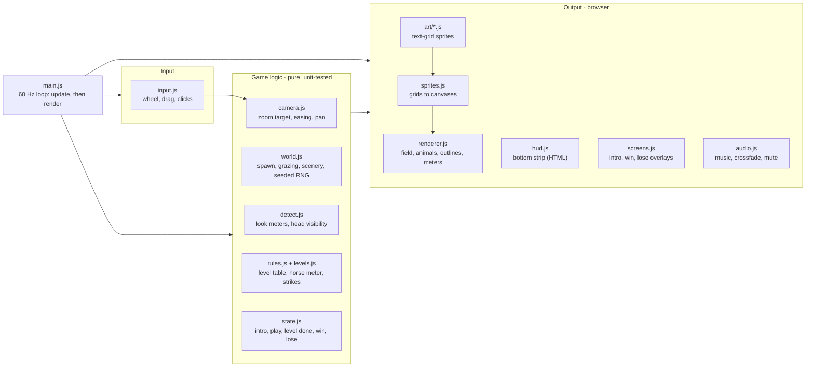
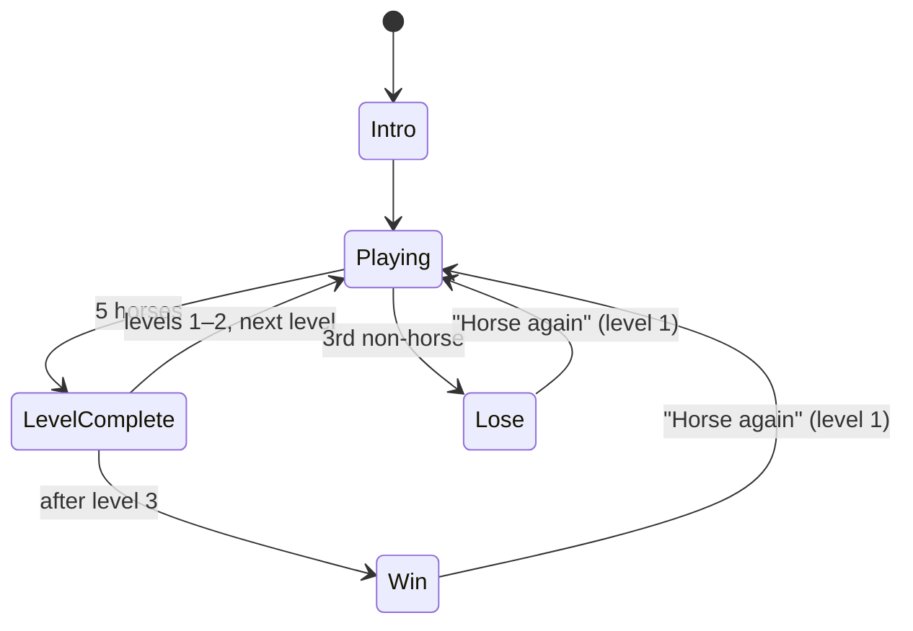

# Horse Looker 4000 — Implementation Plan

This is the live plan for building the MVP. It was copied from the "Horse Looker 4000 — Implementation" doc on 2026-10-20, and that doc is now deprecated. Claude updates this file and ticks off milestones as they ship.

Game rules live in [DESIGN.md](DESIGN.md). If this plan and DESIGN.md disagree on behavior, DESIGN.md wins: fix this file.

## Summary

Horse Looker 4000 is a static browser game: HTML5 Canvas with plain JavaScript, no engine and no build step, hosted on GitHub Pages. Claude writes, tests, reviews and merges all the code. The project owner plays each build and gives feedback. Numbers marked _(tune)_ are starting values to adjust after playtesting.

## Milestones

Each milestone ships as its own PR and leaves a working build on GitHub Pages. Builds marked **Play it** are worth the owner's feedback.

- [x] **1. Scaffolding:** the repo files listed under [AI-first workflow](#ai-first-workflow), CI, the Pages deploy, and a blank canvas live at the Pages URL.
- [x] **2. Pasture and zoom:** procedural hills and grass, cursor-centered eased zoom, drag to pan, vignette and zoom readout. **Play it:** does zooming feel good?
- [x] **3. Sprites:** three horse breeds at all four tiers, barns, California live oaks and datacenters, and the sprite review page. The owner approves the look from its screenshot before moving on.
- [x] **4. Looking at horses:** animals spawn and graze on their own hill (each belongs to one hill layer and never crosses a ridge yet), look meters, looked-at detection, outlines, bottom strip and horse meter. **Play it:** is the looked-at threshold right?
- [x] **5. Rules and levels:** level table (replacing milestone 4's sandbox of 30 horses), look-alike placeholders as plain shapes, strikes, level-complete card.
- [x] **6. Screens:** intro, win and lose screens, "Horse again". **Play it:** a full game, start to finish.
- [x] **7. Hills with depth:** animals in the valley behind a ridge are hidden by the hill in front; animals cross ridges by sinking behind the crest and rising over it; heads peeking over a crest can be looked at. Comes after the full game is playable, so it can't delay it; staying on one hill (milestone 4) is the fallback. **Play it:** do peeking horses add fun without making horses too hard to find?
- [x] **8. Look-alike art:** goats, sheep, centaurs, reverse centaurs, robot horses and horse suits. The owner picked and refined each from alternatives shown beside the horse breed it copies. Goats, sheep, centaurs and robot horses differ from their horse by a few pixels at Far; reverse centaurs and horse suits are jokes you can spot from Far. **Play it:** are the look-alikes hard enough, and are the jokes funny?
- [x] **9. Animation:** two-frame walk and head-down graze for every creature at the Mid and Near tiers. The walk frame swings each creature's own legs; the horse's graze frame is hand-drawn and the look-alikes built on the horse wear its lowered head. **Play it:** does the pasture feel alive?
- [x] **10. Music:** Claude shortlisted licensed, calming tracks for each level and the owner picked by ear: "Etirwer" (level 1), "Feel Good Island Loop" (level 2) and "Porch Swing Days - faster" (level 3). Playback, 2 s crossfades, the remembered mute button and credits are in `src/ui/audio.js`. **Play it:** does each level sound right?
- [ ] **11. Tuning pass:** adjust every _(tune)_ value from playtest notes. **Play it:** MVP done.

## Technology stack

Everything the player downloads is plain files. Node is used only for development tools, never at runtime.

| Layer           | Choice                                                                       | Why                                                                  |
| --------------- | ---------------------------------------------------------------------------- | -------------------------------------------------------------------- |
| Language        | JavaScript (ES modules), JSDoc types checked with `tsc --noEmit`             | Runs in the browser as-is; types catch mistakes without a build step |
| Rendering       | HTML5 Canvas 2D, `imageSmoothingEnabled = false`                             | Smooth zoom, crisp pixel art, small API                              |
| Sprites         | Pixel art defined in code as text grids, drawn to offscreen canvases at load | No binary files; art is written, diffed and reviewed like code       |
| UI chrome       | HTML + CSS overlaid on the canvas (bottom strip, text screens, buttons)      | Text and layout are easier in HTML than in canvas                    |
| Audio           | One licensed music track per level, using HTML `<audio>`                     | Simplest way to loop and crossfade; no sound effects in the MVP      |
| Unit tests      | Node's built-in test runner (`node --test`)                                  | Zero dependencies; covers game logic                                 |
| Browser tests   | Playwright, headless Chromium                                                | Smoke tests plus screenshots Claude can look at                      |
| Lint and format | ESLint + Prettier                                                            | Consistent code across sessions                                      |
| CI              | GitHub Actions: lint, typecheck, unit and browser tests on every PR          | The gate that keeps hands-off work safe                              |
| Hosting         | GitHub Pages, deployed from `main`                                           | Free; merge means live                                               |

## Architecture

Game logic is pure and unit-tested. Input feeds it, and the browser layer draws it. Output modules only read game state; they never change it. That keeps every rule testable without a browser.



### Planned layout

```
index.html            entry page: canvas + HTML overlays
src/
  main.js             bootstrap and frame loop
  input.js
  game/               pure logic, no DOM or canvas access
    config.js         every (tune) constant in one place
    rng.js            mulberry32 seeded generator
    camera.js  world.js  detect.js  play.js  rules.js  levels.js  state.js
  render/
    renderer.js  sprites.js  palette.js
    art/              text-grid sprites, one file per creature or object
  ui/
    hud.js  screens.js  audio.js
audio/                licensed music tracks
tools/sprites.html    dev-only sprite review page
test/                 node --test unit tests
e2e/                  Playwright smoke and screenshot tests
```

## Game logic

### Game states



- **Intro:** show the three opening lines in turn. Each fades in over 0.6 s, holds (1.2 s, 3.2 s and 3 s for the three lines), then fades out _(tune)_. A click skips to the next line. `?intro=off` (for tests) and `?level=n` skip it.
- **Playing (level n):** the main loop below.
- **Level complete:** a short "Level n complete" card (2.5 s _(tune)_), then the next level is generated from the game's seed and the level number, with the whole pasture in view. `?level=n` starts a game at a later level for playtesting.
- **Win / Lose:** the end screens from DESIGN.md, fading in over the game in 1.5 s. The lose screen shows horses and non-horses looked at over the whole game, the level reached, and a chip for every animal looked at. "Horse again" skips the intro and starts level 1 with a new random pasture (or the same one again when the URL has `?seed=`). `?screen=win` and `?screen=lose` open straight on an end screen with a sample of looks, for testing.

### World and animals

- The pasture is a fixed world rectangle, 4000 × 2500 world units. Hills and grass are drawn procedurally from a seed.
- Each animal has `kind` (horse, goat, sheep, centaur, reverseCentaur, robotHorse, horseSuit), `breed` (A, B, C, or none), `color`, `x`, `y`, `facing`, `lookMeter` and `lookedAt`.
- Animals spawn at random positions with a minimum spacing, so two never overlap at close zoom.
- Animals graze: they idle, then walk a short distance in a random direction and stop. Walking alternates two frames 4 times a second (`WALK_FRAME_RATE`). 70% of rests are spent with the head down (`GRAZE_CHANCE`), lifting it 1 s before walking off (`GRAZE_LOOK_UP_S`) _(tune)_. The head box follows the pose, so a grazing head can drop behind a crest. They stay inside the pasture and walk around scenery.
- **Scenery:** barns, California live oaks and datacenters are placed at level start, before animals, and never overlap each other. Each object stands on one hill, like animals. Datacenters are the largest, at least twice a barn's size. Starting sizes: a barn about 5 horses wide, a live oak about 4 horses wide and 3.5 tall (a broad, rounded, low-spreading canopy on a short dark trunk), a datacenter about 10 horses wide. Level 1 gets 3 barns, 6 live oaks and 1 datacenter; levels 2 and 3 get 5 barns, 12 live oaks and 1 datacenter _(tune)_. Lots of taller grass tufts grow around each live oak's trunk _(tune)_. Animals can pass behind scenery. Everything is drawn back to front by its base, so a horse behind a barn is partly hidden.
- All randomness comes from a seeded generator (mulberry32). A fixed seed makes tests and bug reports reproducible.

### Hills with depth

Each hill is a layer. Everything on the pasture (animals and scenery) belongs to exactly one hill and is drawn after that hill and before the next one in front. That ordering does the hiding: the hill in front covers anything behind its crest. Milestone 4 builds the layers with animals staying on their own hill; milestone 7 adds valleys and crossings.

- **Terrain:** generation keeps a minimum gap between neighboring ridges at every x (about 150 world units _(tune)_), so slopes never pinch shut or cross.
- **Valleys:** behind each crest is a hidden strip of ground (about 1.5 horse-heights deep _(tune)_). An animal there belongs to the hill behind and sits below the crest of the hill in front, so it is partly or fully hidden.
- **Crossing toward the viewer:** walk down into the valley behind the next hill (sinking out of sight), rise behind its crest head first, then switch to the front hill's layer at the crest and walk down its slope. **Away from the viewer:** the same steps in reverse. Each crossing is a small scripted sequence of states, so it is easy to unit-test.
- **How often:** each time a grazing animal sets off, there is a 20% chance it heads over a ridge instead _(tune)_. Ordinary grazing can also wander into the valley behind the next crest, and animals spawn anywhere on their hill's ground, so some start each level in a valley.
- **Head visibility:** a head counts as visible only if the head box is above every crest in front of the animal's hill and not covered by scenery. A horse peeking over a crest can be looked at; one fully behind it can't.
- **Scenery** never sits in a valley, so barns and trees always stand on a visible slope.
- **Cost:** hiding comes from draw order, not extra drawing. Per tick, each animal checks a few nearby ridges (three sine waves each), which is negligible.

### Camera and zoom

- The camera is `{x, y, zoom}`. Zoom ranges from the whole pasture fitting the screen to 64× _(tune)_. A horse is 24 × 16 world units, so it is a ~5 px dot at ×1 and about 40% of an 800 px tall view at ×64.
- Each wheel event sets a target zoom: `target *= exp(-deltaY × k)`. `deltaY` is normalized first, because mice and trackpads report very different amounts.
- Zoom is centered on the cursor: the world point under the cursor stays under the cursor.
- Each tick, zoom eases toward its target in log space: `log zoom += (log target − log zoom) × (1 − e^(−dt·12))`, so zooming feels equally smooth at every depth.
- Click-and-drag pans the view, clamped to the pasture edges.

### Looked-at detection

- Each animal has its own look threshold, spread evenly from the Mid tier (32 px tall on screen, the zoom where look-alike telltales first show) up to 20% more zoom (38.4 px) _(tune)_. It is fixed at spawn from a side branch of the animal's own generator, so seeds keep their pastures. (Before the 2026-10-20 tuning, thresholds were 8–15% of the viewport height; from then until 2026-10-21 every animal shared the Mid tier.)
- An animal's look meter fills while all three of these hold: it is zoomed in to its own threshold or closer, its center is on screen, and its head is visible.
- The meter fills over 0.5 s and drains at twice that speed when any condition stops _(tune)_. A full meter means looked at.
- Every qualifying animal on screen fills its own meter at once, not just the one under the cursor. That is the risk the player manages near goats and look-alikes.
- **Look meter display:** a thin bar above each filling animal's head, in neutral white so it doesn't give away what the animal is. Meters are drawn on top of everything.
- **Head visibility:** each sprite marks a head box. The head is hidden when any scenery drawn in front of the animal covers the box's center, or a hill in front rises above it.
- Once looked at, the animal stays marked and is never counted twice.
- **Reaction:** a newly looked-at animal stands still for 2.5 s _(tune)_ and says its line in a speech bubble drawn above its head, over everything, at a fixed screen size. Horses rear up for the first 1 s _(tune)_: a frame made in code by turning the body up about the hip over the planted hind legs (`rearFrame` in `src/render/art/motion.js`). A robot horse fires red lasers from its eye for the first 0.8 s _(tune)_, starting a small flickering fire in the grass in front of it that burns until the reaction ends. The horse suit's split into two people is a separate change.
- **Marker:** a bright outline traced around the sprite, blue for horses and red for non-horses, generated from the sprite itself at load. At the Dot tier, a ring of the same color circles the dot. Fallback: a rectangular border, if the outline hurts performance or needs complex code.

### Levels

| Level | Animals | Horses   | Goats + sheep        | Other creatures      | Horse breeds                   |
| ----- | ------- | -------- | -------------------- | -------------------- | ------------------------------ |
| 1     | 40      | 50% (20) | 50%, split at random | 0%                   | A only                         |
| 2     | 80      | 20% (16) | 80%, split at random | 0%                   | A, B, C at random, at most 2 A |
| 3     | 80      | 20% (16) | 60%, split at random | 20%, kinds at random | A, B, C at random              |

Each level needs at least 5 horses to be winnable. Levels 2 and 3 have 11 spare horses, which keeps the hunt for the last horse short _(tune)_.

### Scoring, winning and losing

- `horsesThisLevel` reaches 5 → level complete. After level 3 → Win. Levels have no time limit.
- `nonHorsesTotal` counts across the whole game. It reaching 3 → Lose immediately.
- The bottom strip's list resets each level. A game log keeps every looked-at animal for the end screens.

### Frame loop

`requestAnimationFrame` drives a fixed 60 Hz update step (input, camera, animals, detection, rules), then one render. Logic never depends on frame rate.

## Assets

Every MVP sprite is a text grid in code, at three sizes per creature, plus a colored dot for far zoom: 7 creatures × 3 sizes = 21 grids, 28 animation frames (walk and graze at Mid and Near: the walk frames are made in code by swinging each creature's legs, the horse's graze frames are hand-drawn grids), and 3 scenery objects × 3 sizes = 9 more grids. Scenery (barns, live oaks, datacenters) is far larger than an animal, so instead of hand-typed grids it is drawn by small functions in `src/render/art/` that output a grid at each tier's density. Those functions are pure, deterministic and unit-tested like the hand-made grids.

A sprite grid looks like this, with `.` as transparent and each other character mapped to a palette color:

```
..mm........
.mBBm.......
..BBBBBBBBt.
...BBBBBBBt.
...l.l..l.l.
```

The renderer turns grids into offscreen canvases at load. Breeds share shapes and swap palettes. PNG sheets can replace any grid later without changing game code.

### Zoom tiers

The renderer picks a tier by how tall a horse is on screen, then scales the sprite to its exact size with smoothing off. (Snapping to whole-pixel multiples would make sprites jump in size during smooth zooming.) Each tier has a fixed density: 0.5, 1 and 2 grid pixels per world unit for Far, Mid and Near, so scenery and animals always share one pixel size.

| Tier | On-screen size | Sprite                     | What the player can tell                                               |
| ---- | -------------- | -------------------------- | ---------------------------------------------------------------------- |
| Dot  | under 8 px     | 1–3 px blob, drawn in code | Color only. Breed B and a goat look identical                          |
| Far  | 8–32 px        | 12 × 8 grid                | Body shape, plus a few pixels of difference: a horn, metal legs        |
| Mid  | 32–128 px      | 24 × 16 grid               | Telltales: horns and beard, a centaur torso, robot joints and LED eye  |
| Near | over 128 px    | 48 × 32 grid               | Full detail: mane, face, hooves. Most looks finish before this, in Mid |

Goats, sheep, centaurs and robot horses differ from their horse by only a few pixels of shape or color at Far, so the player has to zoom to Mid to be sure. Reverse centaurs and horse suits are jokes that show from Far. Cutoffs are _(tune)_.

### Palette

| Use                      | Colors                                                                                                           |
| ------------------------ | ---------------------------------------------------------------------------------------------------------------- |
| Breed A, Friesian        | Black coat, dark gray highlights, black mane                                                                     |
| Breed B, Haflinger       | Golden chestnut coat, blond mane and tail                                                                        |
| Breed C, Camarillo White | White coat, light gray shading, dark eyes and hooves                                                             |
| Look-alikes              | Same coat colors as their paired breed, per DESIGN.md                                                            |
| Looked-at outline        | Blue for horses, red for non-horses (blue, not green, so it stands out from the grass)                           |
| Look meter               | Neutral white                                                                                                    |
| Pasture                  | Three or four greens for hills, plus grass tufts drawn procedurally at close zoom, thickest around the live oaks |

### Reviewing art

A dev-only page, `tools/sprites.html`, shows every sprite at every tier on the grass background. Claude screenshots it with Playwright to check the art and attaches the screenshot to the PR. Art is a visual-taste question: the owner approves it before merge.

## Music

Each level gets its own simple, calming track that loops while playing.

- **Choosing tracks:** Claude finds 3–4 candidates per level and posts links on the PR. The owner listens and picks, since Claude can't hear audio. Claude then adds the picks with credits.
- **Allowed licenses:** CC0 / public domain (e.g. OpenGameArt filtered to CC0), or CC BY 4.0 (e.g. Kevin MacLeod at incompetech). Not the Pixabay Content License, which restricts redistributing files as-is from a public repo. Check each track's license before committing it.
- **Credits:** a "Music by…" line on the win and lose screens, and a `CREDITS.md` listing each track, artist, source link and license.
- **Playback:** one looping `<audio>` element per level, with a 2 s crossfade between levels _(tune)_ at a volume of 0.6 _(tune)_. The intro is silent; the current level's track plays from the start of the level, keeps playing under the win screen and fades out on the lose screen. Sound starts after the player's first click or key press, because browsers block autoplay; the intro's click-to-skip covers this.
- **Mute:** a speaker button at the right end of the bottom strip, kept above the full-window screens. The setting is remembered between visits.
- **Files:** Ogg Vorbis tracks of up to about 4 MB each in `audio/`, listed in `src/ui/tracks.js`.

## User interface

The pasture fills the window, and a 96 px strip along the bottom tracks progress. Everything outside the canvas is HTML and CSS.

```
+--------------------------------------------------------------------+
| x12                                                                |
|        .            o(red)                  .                      |
|                              +                       .            |
|     .                                [==   ] look meter           |
|                     o(blue)          .                            |
| Pasture canvas · crosshair · drag to pan · vignette edges          |
+--------------------------------------------------------------------+
| Level 2 / 3          Imposters 2/3    Looked at (newest first)  [M]|
| Horses 4/5           (*)(*)( )        [Haflinger][Goat][Friesian]  |
| [#][#][#][#][ ]                                                    |
+--------------------------------------------------------------------+
```

- **Viewport (canvas):** crosshair cursor, a soft dark vignette at the edges to suggest a telephoto lens, and a camera-style zoom readout ("×12") in a corner. Look meters appear above animals as they fill.
- **Level and progress:** "Level 2 / 3" and a 5-slot horse meter that fills as horses are looked at.
- **Imposters (strikes):** three slots labeled "Imposters" that turn red per non-horse, visible from the start. The game ends on the third.
- **Looked-at list:** a horizontal row with the newest on the left. Each chip shows the Near sprite as an icon plus a label ("Haflinger", "Goat"), with a blue or red edge to match the field marker.
- **Mute button:** at the right end of the strip.
- **Text screens:** intro, level complete, win and lose are full-window HTML overlays with bold white text on black, fading with CSS transitions.
- **Window size:** desktop browsers with a mouse or trackpad, 1024 px wide or more. Phones are out of scope for the MVP.

## AI-first workflow

Claude does all the coding, code review and merging; the owner plays the live build and reports what feels wrong. The repo carries everything a fresh Claude session needs, so no session depends on another's memory.

### Files in the repo

| File                                          | Purpose                                                                                                   |
| --------------------------------------------- | --------------------------------------------------------------------------------------------------------- |
| `CLAUDE.md` (with `AGENTS.md` pointing to it) | Project rules: stack, commands, code style, definition of done, what not to do                            |
| `docs/DESIGN.md`                              | The game rules. The only version referenced and updated during MVP development                            |
| `docs/IMPLEMENTATION_PLAN.md`                 | This plan. Claude updates it and ticks off milestones as it ships                                         |
| `docs/DECISIONS.md`                           | A short log of choices and why, so later sessions don't re-argue them. Seeded from the decision log below |
| `.github/workflows/ci.yml`                    | Lint, typecheck, unit and browser tests on every PR                                                       |
| `.github/workflows/pages.yml`                 | Deploys `main` to GitHub Pages                                                                            |
| `.github/ISSUE_TEMPLATE/playtest.md`          | A short form for gameplay feedback                                                                        |
| `.claude/settings.json`                       | Pre-approved commands (npm scripts, Playwright) to cut permission prompts                                 |
| `CREDITS.md`                                  | Music and any other third-party assets, with licenses (added in milestone 10)                             |

### The loop

1. The owner files playtest feedback as a GitHub issue using the playtest template. Rule changes go into `docs/DESIGN.md` through an issue and a PR. Quick back-and-forth can happen in a Claude chat, but anything actionable becomes an issue.
2. A Claude session takes one issue or milestone, branches, implements it and adds tests.
3. It runs the checks locally, and screenshots the game with Playwright to see the change.
4. It opens a PR. A separate Claude review pass checks the diff against `CLAUDE.md` and `docs/DESIGN.md`.
5. Claude fixes review findings until CI is green, then merges the PR itself and Pages deploys. If the PR involves a question of UI or visual taste, Claude asks the owner on the PR first and waits for an answer before merging.
6. The owner plays the new build and files the next round of feedback.

### Definition of done for any change

- Lint, typecheck and all tests pass
- New game logic has unit tests
- Visible changes include a screenshot in the PR
- `docs/IMPLEMENTATION_PLAN.md` and `docs/DECISIONS.md` are updated when relevant

## Post-MVP ideas

Not in the MVP. Each needs the owner's go-ahead and a DESIGN.md change before it's built.

- **Horse suit reveal:** looking at a horse suit plays an animation: the two humans take the suit off and run off in different directions. The owner asked for this with the other looked-at reactions (2026-10-21); it ships as its own change.

## Post-MVP creature images

Recommendation: a scripted pipeline in the repo. A script calls an image API to make one large master image per creature, using the MVP sprite as the reference for pose and colors. It then shrinks that master to each zoom tier and snaps it to the palette. Claude can't draw images itself, but it can write and run this script, look at the results, and redo weak ones.

| Option                                                                                | How it works                                                                                   | Consistent across creatures and zooms?           | Hands-off?                              |
| ------------------------------------------------------------------------------------- | ---------------------------------------------------------------------------------------------- | ------------------------------------------------ | --------------------------------------- |
| Chat tools by hand (ChatGPT, Gemini)                                                  | The owner prompts each creature, downloads, and hands the files to Claude                      | Weak: each image drifts in style, size and angle | No                                      |
| General image API, scripted (OpenAI, Google Gemini/Imagen, Flux via Replicate or fal) | Claude writes a script with fixed prompts and seeds, using the MVP sprite as a reference image | Good with reference images; needs a review pass  | Yes, with an API key in the environment |
| Pixel-art generator with an API (e.g. PixelLab, Retro Diffusion)                      | Tools built for game sprites at fixed small sizes, often with style and character locking      | Strongest for pixel art at a set size            | Yes, if the API covers what we need     |
| Local Stable Diffusion with a style model                                             | Run models on your own GPU, trained on a style                                                 | Very strong once tuned                           | No: heavy setup and upkeep              |

- **One master per creature, shrunk by code.** Every tier comes from the same image, so shapes and colors match. A script using `sharp` or ImageMagick resizes and snaps colors to the palette.
- **Keep code grids for Dot and Far.** At 12 × 8 pixels, a shrunk image turns to mush.
- **Lock the gameplay telltales.** Coat colors and telltales (horns, robot legs, black shoes) are checked against DESIGN.md, so new art can't make a look-alike too easy or too hard.
- **Review the same way as MVP art,** on the sprite review page with screenshots in the PR.

Vendor names come from general knowledge. Check current features, pricing and image licensing before choosing one.

## Decision log

Settled while planning (2026-10-20). The running log, including later decisions, is `docs/DECISIONS.md`.

| Decision          | Choice                                                                                                                              |
| ----------------- | ----------------------------------------------------------------------------------------------------------------------------------- |
| Platform          | Browser; HTML5 Canvas + plain JavaScript, no engine, GitHub Pages. Phaser is the fallback if we need physics or heavy animation     |
| MVP sprites       | Code-drawn text grids; AI-generated PNGs are a post-MVP upgrade                                                                     |
| Horse breeds      | A Friesian (black), B Haflinger (golden chestnut), C Camarillo White (white)                                                        |
| Looked-at marker  | Sprite outline, blue for horses, red for non-horses; rectangle fallback                                                             |
| Lose condition    | 5 non-horses over the whole game                                                                                                    |
| Animation         | Two-frame walk and graze, as its own milestone after the game is playable                                                           |
| Scenery           | Barns, California live oaks and datacenters (largest, at least twice a barn)                                                        |
| Zoom tiers        | Four tiers (Dot, Far, Mid, Near) with cutoffs as written; telltales first show at Mid                                               |
| Looked-at trigger | Per-animal threshold of 15–30% of viewport height, a 1 s look meter, every qualifying animal on screen counts, head must be visible |
| UI layout         | Bottom strip; strikes visible from the start; drag to pan                                                                           |
| "Horse again"     | Skips the intro, straight to level 1                                                                                                |
| Level sizes       | 40, 80, 80 animals; no time limit                                                                                                   |
| Music             | One calming licensed track per level; Claude shortlists, the owner picks                                                            |
| Merging           | Claude merges its own PRs, but asks the owner first on UI or visual-taste questions                                                 |
| Feedback          | Playtest notes in GitHub issues; rule changes via `docs/DESIGN.md`                                                                  |
